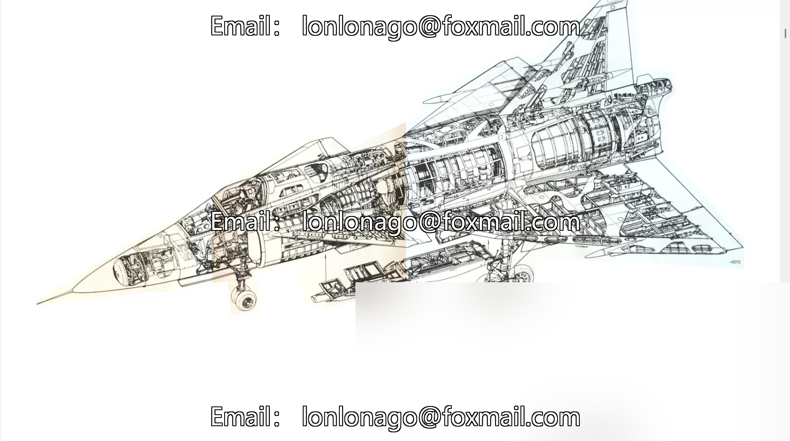
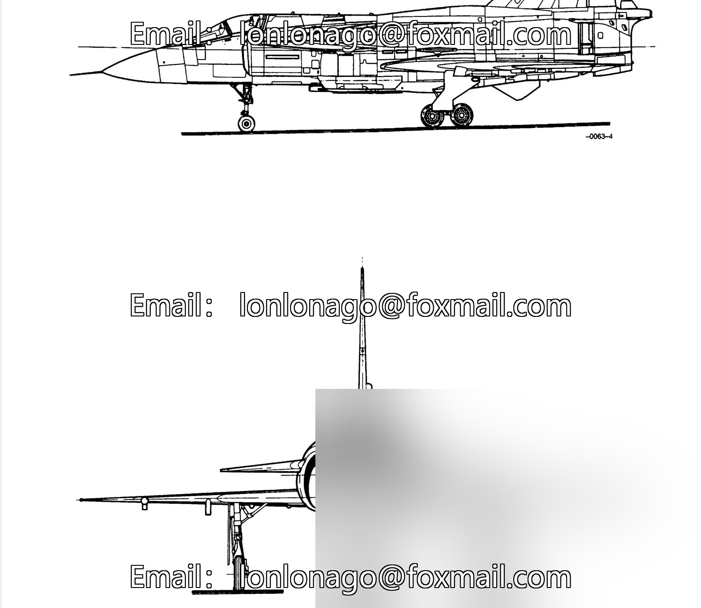
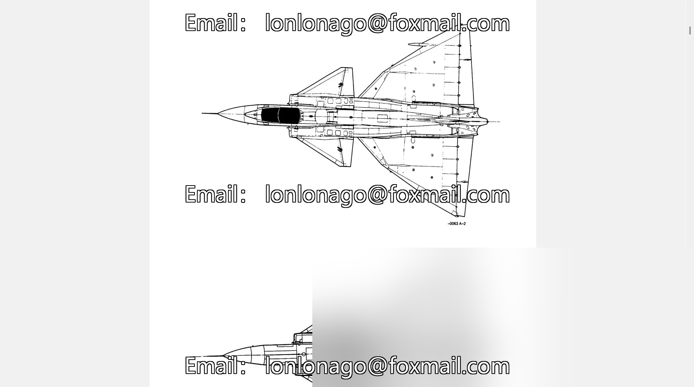

# The official Flight Manual of the Swedish Air Force JA37 "Viggen" fighter

## Body

Official 《Flight Manual》 of the Swedish Air Force JA37 "Viggen" fighter, 490-page PDF file
JA37 "Viggen". This is the all-weather interception variant of the Saab "Viggen" series fighter, specifically designed for Swedish domestic air defense. Its core task is to rapidly intercept high-altitude invading bombers and reconnaissance aircraft.
JA37 is renowned for its unique design (Duck tail configuration, short-range takeoff and landing capability) and powerful PS-46 radar combined with the interception capability of the "Sky Flash" missile.

The official Flight Manual for Sweden's Air Force JA37 "Viggen" is a 490-page PDF document covering the aircraft.

<!-- AI_ENRICHED -->

## Images

## Payment

Here is a pay link on Stripe ( https://buy.stripe.com/3cs8yP7sY87d0vu9AB ). Please contact me lonlonago@foxmail.com after funding $89, and I will send you a complete data files , thank you!

